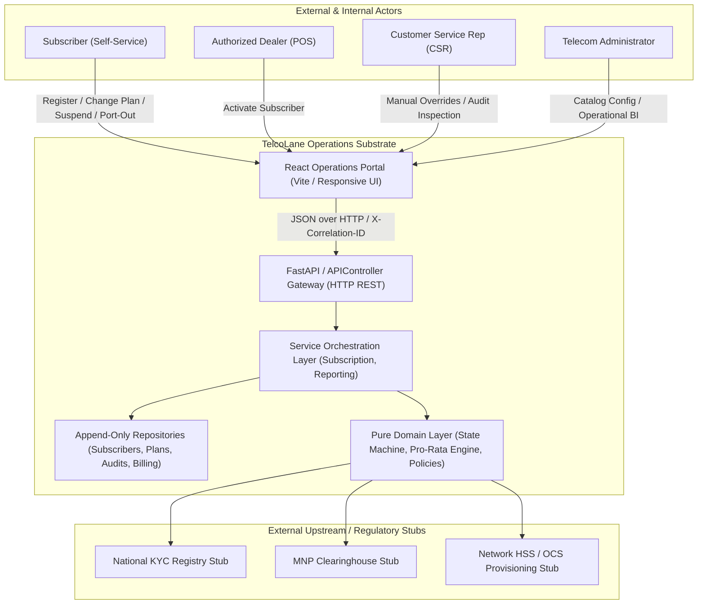
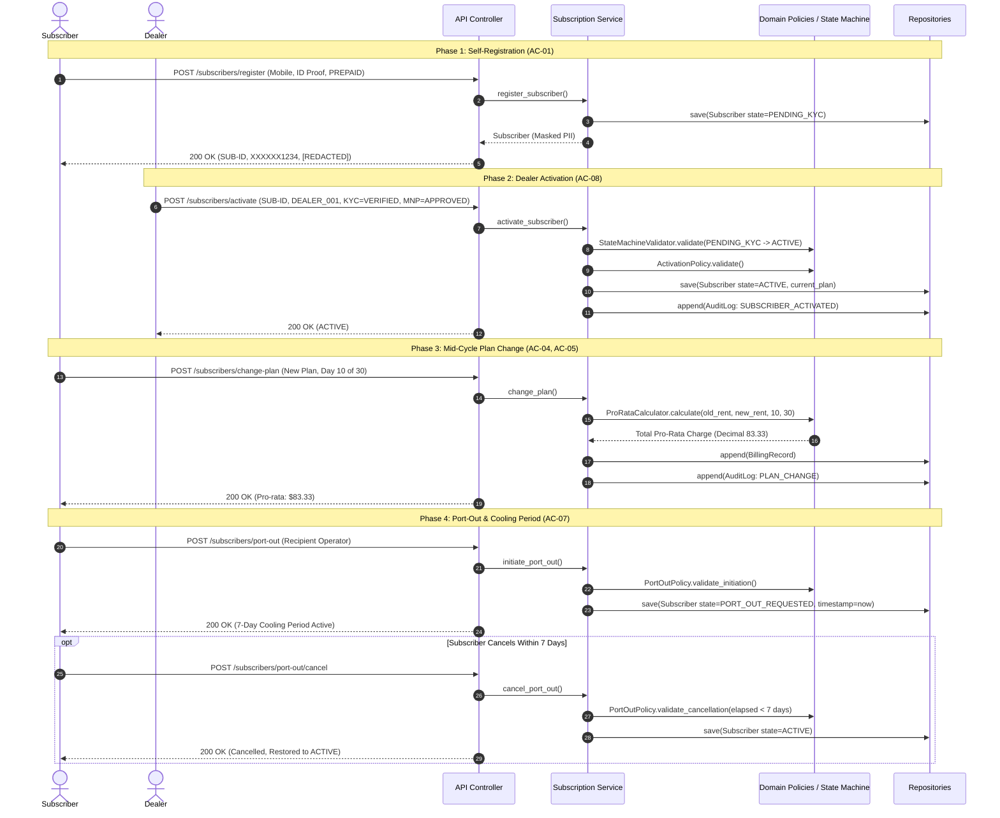

# TelcoLane Architectural Specification (architecture.md)

**System:** TelcoLane Subscriber & Plan Lifecycle Operations Platform  
**Document Version:** 1.0.0  
**Architectural Discipline:** Strict Layer Isolation · Domain Driven Design · Invariant Safety  

---

## 1. System Overview & C4 Context Diagram
TelcoLane coordinates retail subscribers, retail dealers, customer service representatives (CSRs), and telecom administrators with external provisioning stubs and national clearinghouses.

---

## 2. Layered Architecture Structure
The codebase strictly adheres to directional dependencies:  
`Controllers` $\to$ `Services` $\to$ `Repositories` $\to$ `Domain`.  
The `Domain` layer contains zero framework imports and zero outer-layer references, enforced by automated architecture tests and `.claude/hooks/architecture-layering-check.sh`.

```mermaid
flowchart LR
    subgraph Layer1 [1. Controller Layer]
        C1["APIController"]
        C2["FastAPI Main Routes"]
        C3["Correlation & PII Masking Filters"]
    end

    subgraph Layer2 [2. Service Layer]
        S1["SubscriptionService"]
        S2["ReportingService"]
        S3["Audit Logger Coordinator"]
    end

    subgraph Layer3 [3. Repository Layer]
        R1["SubscriberRepository"]
        R2["PlanRepository (Versioned)"]
        R3["AuditRepository (Append-Only)"]
        R4["BillingRepository"]
    end

    subgraph Layer4 [4. Pure Domain Core]
        D1["Models & Exceptions"]
        D2["StateMachineValidator"]
        D3["ProRataCalculator (Decimal)"]
        D4["ActivationPolicy"]
        D5["PlanChangePolicy"]
        D6["PortOutPolicy"]
        D7["SuspensionPolicy"]
        D8["CSROverridePolicy"]
    end

    Layer1 --> Layer2
    Layer2 --> Layer3
    Layer2 --> Layer4
    Layer3 --> Layer4
```

---

## 3. End-to-End Sequence: Activation to Port-Out Lifecycle
This sequence illustrates the complete lifecycle path of a subscriber from registration through activation, plan migration with pro-rata billing, and 7-day port-out cooling period management.

---

## 4. Architectural Invariants Enforced by Tests
1. **Layer Dependency Direction**: Domain never imports from controllers, services, repositories, or external frameworks (`tests/architecture/test_layering.py`).
2. **Financial Precision**: Floating-point casts (`float()`) are strictly forbidden across domain calculations (NFR-01).
3. **Plan Immutability**: Published plan records (`is_published=True`) cannot be updated in place (NFR-02).
4. **Duplicate Active Mobile Number Guard**: An identical mobile number cannot hold more than one ACTIVE subscription concurrently (NFR-08).
5. **PII Masking**: Mobile numbers and identity proof references are masked across logs and public payloads (NFR-03).
